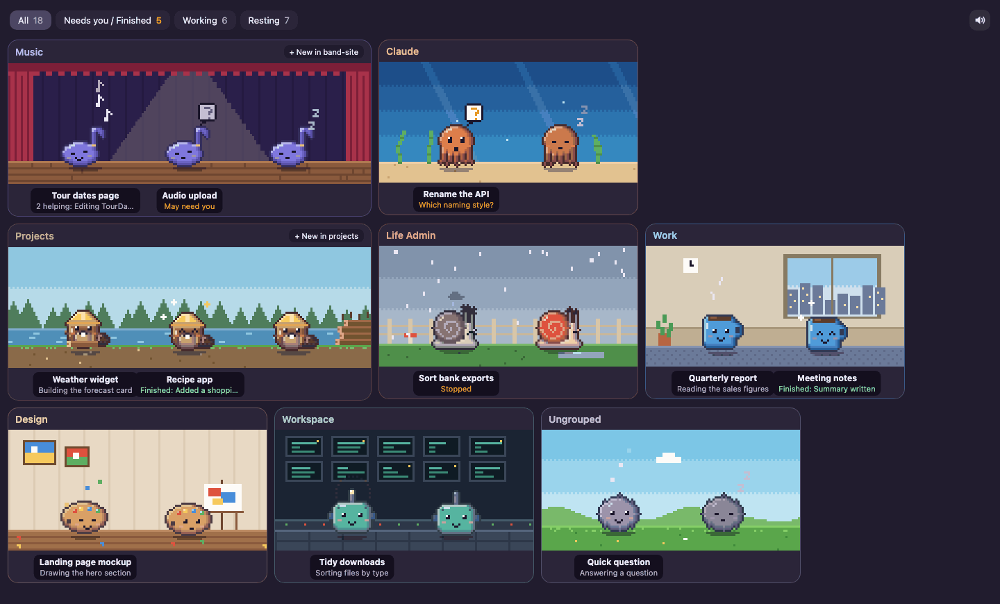

# Agentlings

**Stop tab hunting. See every Claude session as a little pixel creature.**

If you run a lot of Claude sessions, you know the routine: click through tabs to find the one that's waiting on you. Agentlings ends that. Every session becomes a pixel creature, grouped the same way as your Claude sidebar. Working ones get busy, ones that need you wave, finished ones celebrate until you look, and forgotten ones fall asleep. Each group gets its own creature and its own little world: a beaver on a riverbank for projects, a robot in a control room for tools. Everything is drawn in code, so you can ask Claude to make a creature and a background for any group you like.



Agentlings is an unofficial side project. It is not made by, or affiliated with, Anthropic.

## What it does

- **One hub per sidebar group.** Each group gets its own creature and background: notelings on a stage, an octopus under the sea, a beaver on a riverbank, and so on. Groups without a creature of their own get a fluff in the group's colour.
- **Creatures act out their session.** They work, wave a "?" when a session needs you, bounce when one finishes and keep celebrating until you open it, sulk under a rain cloud when one fails, and get drowsy, fall asleep and slowly fade the longer a session sits untouched.
- **Views.** Filter to All, Needs you / Finished, Working or Resting.
- **Menu bar count** of sessions that need you, with a menu to jump straight to them.
- **Click** a creature to open its session in Claude. **Right-click** to dismiss or hide it. Hidden sessions live in a dropdown, with a button to archive them.
- **"+ New in folder"** starts a new session in that hub's project folder.
- **An alert sound per creature** when a session starts needing you or fails, with a mute button.

## How it works

Claude desktop keeps a small JSON record for each Claude Code session in `~/Library/Application Support/Claude/claude-code-sessions/`, and mirrors your sidebar groups into `claude_desktop_config.json` in the same folder. Agentlings watches those files, only ever reads them, and works out each session's state from the timestamps and labels in them. Opening and starting sessions go through Claude's own `claude://` links.

These files are Claude's internal format, not a public API. A Claude update can change them without warning and break Agentlings. If that happens, the reading code is in `crates/hub-core`, and it is a good job to hand to Claude Code. If the sidebar groups can't be read, Agentlings falls back to grouping sessions by project folder and says so at the top of the window.

## Privacy

Agentlings runs entirely on your Mac. It has no network access, no analytics and no accounts, and it sends nothing anywhere.

It reads, and never changes:

- the session records in `~/Library/Application Support/Claude/claude-code-sessions/`
- your sidebar groups in `~/Library/Application Support/Claude/claude_desktop_config.json`. Only the group settings are used. The rest of that file, which holds your connector settings, is ignored and never kept
- Claude Code transcripts in `~/.claude/projects/`, to show what each session is doing

It saves a few things of its own in `~/Library/Application Support/dev.cristiandonofrio.agentlings/`: which alerts you've dismissed, whether sound is muted, and its alert sounds. The sessions you hide and the view you picked are kept in the window's own storage.

Opening a session, "+ New" and "Archive in Claude" hand over to the Claude app through `claude://` links. "Archive in Claude" starts a new Claude session listing the sessions to archive, which Claude then treats like any other message you send it.

## Requirements

- macOS
- Claude desktop, with some Claude Code sessions
- Node.js 20 or later
- Rust (stable), installed with [rustup](https://rustup.rs)
- Xcode Command Line Tools (`xcode-select --install`)

## Setting it up

The easy way is to let Claude Code do it. Clone the repo, open a Claude Code session in the folder and say:

> Set up Agentlings for me by following SETUP.md.

It will check the requirements, build the app, match your sidebar groups to creatures and open it.

To do it by hand:

```bash
git clone https://github.com/cristiandonofrio/agentlings.git
cd agentlings
npm install
npm run bundle
open "target/release/bundle/macos/Agentlings.app"
```

The app isn't signed, which is fine when you build it yourself. If you copy the built app to another Mac, macOS will warn about an unidentified developer the first time. Right-click the app and choose Open to get past it.

## Choosing creatures

`src/lib/species.json` says which creature lives in which hub. It is made from `src/lib/species.example.json` the first time you build, and git ignores it, so your group names stay on your machine.

```json
{
  "music": {"species": "noteling", "colour": "#7F77DD", "scene": "stage"},
  "projects": {"species": "beaver", "colour": "#A0683F", "scene": "riverbank"}
}
```

Each key is a sidebar group name in lower case. Rebuild with `npm run bundle` after editing it.

| Creature | Scene | What it does while working |
|---|---|---|
| `noteling` (a music note) | `stage` | Music notes float up |
| `octopus` | `sea` | Bubbles rise |
| `snail` | `garden` | Leaves a trail |
| `mug` | `office` | Steams |
| `palette` | `studio` | Flicks paint |
| `bot` (a robot with an antenna) | `control` | Its antenna pulses |
| `beaver` (in a hard hat) | `riverbank` | Gnaws a log, wood chips fly |
| `fluff` (the default) | `meadow` | Little puffs |

Any creature can go with any scene, and the colour can be any hex colour.

## Making your own creature

Creatures and backgrounds are small pictures drawn in code, with no image files, so the quickest way to add one is to ask Claude Code. Something like:

> Add a new Agentlings creature: a fox in a scarf, with a snowy forest scene. Follow the README section on making your own creature.

What it needs to touch:

| File | What goes there |
|---|---|
| `src/lib/pixel/pixel.js` | The creature, in `SPECIES`. Each one draws itself on a 24 x 22 grid from simple shapes, and the shading and outline are added for you. Also where its working effect starts (`EMIT`) and what that effect is (in `overlays`) |
| `src/lib/pixel/scenes.js` | The background, in `SCENES`. Each scene paints a box and returns where the floor is |
| `src/lib/species.json` | Which group gets it |
| `tools/make-sounds.py` and `src-tauri/src/sound.rs` | Optional: its own alert sounds. Without them it uses the fluff's |

Check it in the browser with `npm run dev` and `http://localhost:5173/gallery.html` before building. If you make one you like, open a pull request or post it in the issues. New creatures are very welcome.

## Demo mode

To see the app with made-up sessions, for screenshots or just to try it, run it with `AGENTLINGS_DEMO=1`. No sounds play in demo mode.

```bash
npm run demo
```

## Development

| Command | What it does |
|---|---|
| `npm run dev` | Starts the UI dev server. `http://localhost:5173/gallery.html` shows the board with made-up hubs in a browser |
| `npm run test:ui` | Tests the UI logic |
| `cargo test -p hub-core` | Tests the session reading and state rules |
| `npm run bundle` | Builds the app into `target/release/bundle/macos/` |
| `python3 tools/make-sounds.py` | Regenerates the alert sounds |
| `tools/record-demo.sh` | Re-renders `docs/demo.gif` and `docs/screenshot.png` from the gallery page (needs the dev server, Google Chrome and ffmpeg) |

The creatures and scenes are drawn in code on small pixel grids, with no image files, in `src/lib/pixel/`. The window is Svelte 5 in a Tauri 2 shell.

## Licence

MIT. See [LICENSE](LICENSE).
